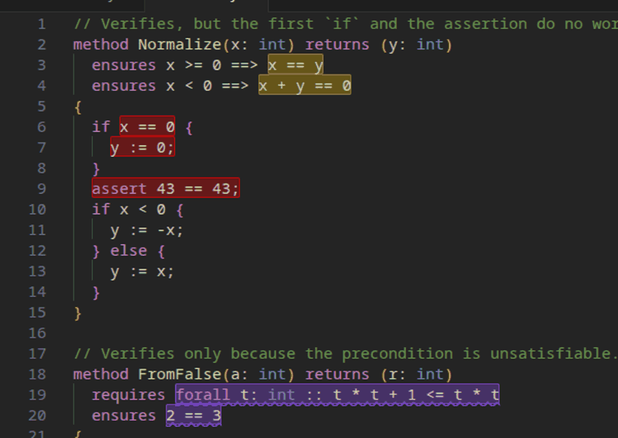
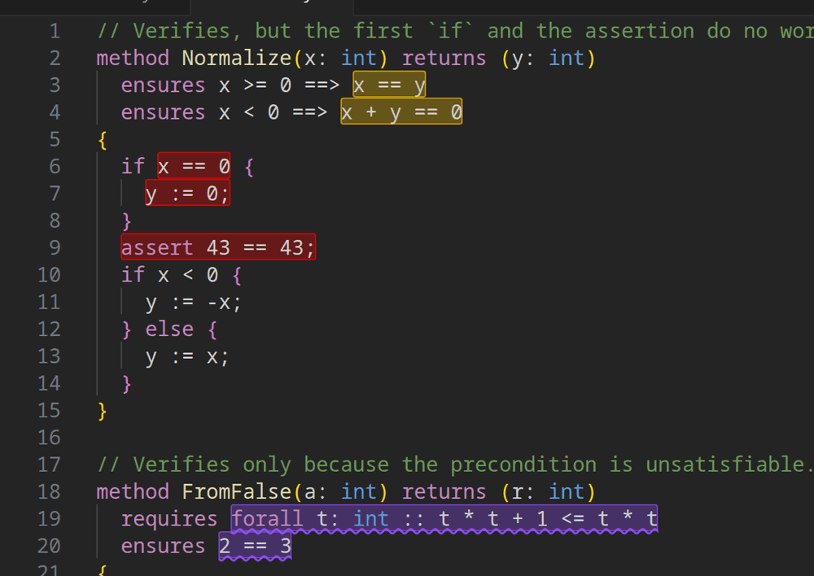
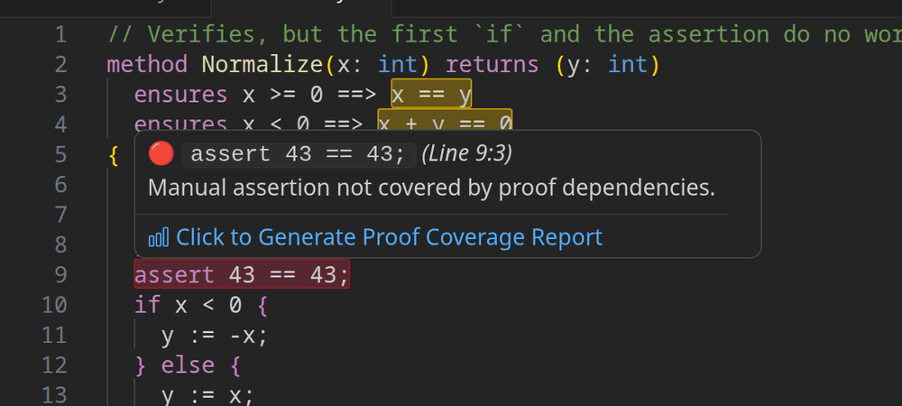
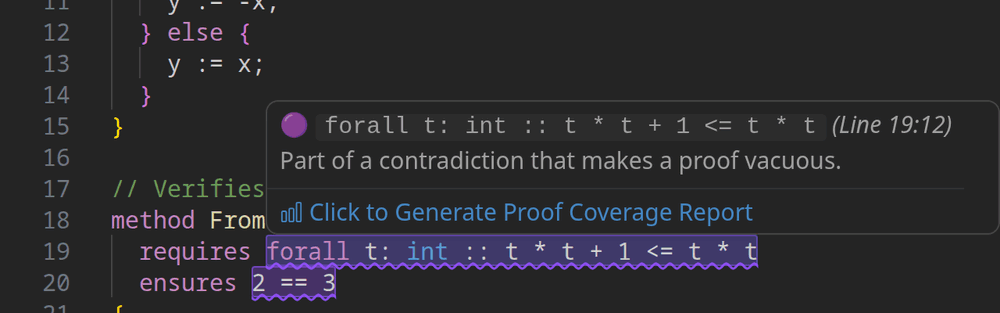
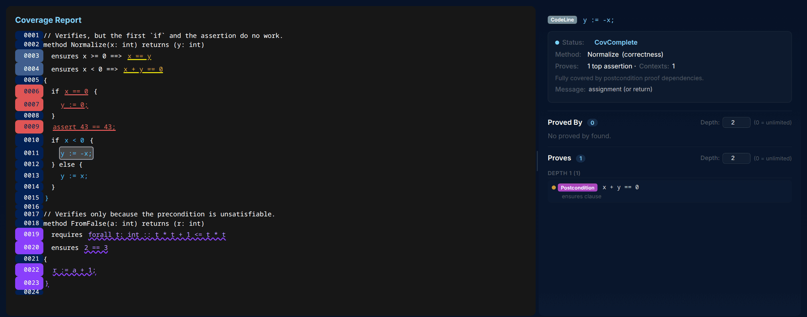

# ProofPulse: see which parts of your Dafny proof actually matter

**Your Dafny program verifies. But which assertions, preconditions, branches and invariants did the work? Which ones are just noise, or worse, hide a proof that holds for the wrong reason?**

ProofPulse answers that inside VS Code. Save a `.dfy` file and it highlights, expression by expression:

- 🔴 **Uncovered**: code and specs no proof needs. Delete everything marked red and the program still verifies.
- 🟡 **Test-only**: specs and code that only matter to test code or callers, not to any postcondition.
- 🟣 **Vacuous**: parts of a contradiction (e.g. an unsatisfiable `requires`) that make a proof pass trivially.
- 🟠 **Unproved**: goals the verifier could not prove during the analysis. The rest of that method's coverage may then be incomplete, and the hover says so.

ProofPulse was presented at **ASE 2026** ([read the paper](https://doi.org/10.1145/3832783.3834600), open access) · [Watch the demo video](https://www.youtube.com/watch?v=8pO3NAodjoQ)



## Getting started

1. Install **ProofPulse** and the official [Dafny extension](https://marketplace.visualstudio.com/items?itemName=dafny-lang.ide-vscode).
2. Open a `.dfy` file. The first time, ProofPulse downloads its own Dafny build (a one-time download with a progress bar) and then analyses the file. This build carries the changes to Dafny and Boogie that ProofPulse relies on, so it is used instead of any Dafny you already have installed.
3. Edit and save. Highlights update every time you save, method by method as each one is verified, so large files show results long before the whole file is done.

No configuration, no Docker, no command line. Prebuilt for Linux x64, macOS (Apple silicon) and Windows x64.

## What it shows you



In this example both methods verify, yet:

- the first `if` and the `assert` in `Normalize` are **uncovered**, because the proof never uses them.
- the postconditions of `Normalize` are **test-only**, because no caller relies on them yet.
- `FromFalse` is **vacuous**: its precondition can never hold, so it "proves" `2 == 3`.

### Hover for the reason

Every highlight explains itself. Hover over it to see its status and why.





### Follow the proof in the browser

Click **Generate Proof Coverage Report** in a hover, or right-click a `.dfy` file and pick **ProofPulse: Get Proof Report**. A report opens in your browser: click any line to see which assertions it proves and what it depends on.



### Condition coverage

Each part of an `if` or `while` condition is checked too. An uncovered part could be replaced by `true` or `false` and the proof would still hold. It decides behaviour the contract leaves open, which usually means a postcondition is missing.

## Who it is for

- **Students and instructors.** Students see which lines of a proof mattered rather than poking at it until it verifies. Instructors can spot vacuous specs and padded proofs in submissions at a glance. See [`demo_examples/`](https://github.com/VeriFixer/ProofPulse/tree/main/demo_examples) for small ready-to-use examples.
- **Engineers maintaining verified code.** Remove dead assertions and lemma calls with confidence, and keep proofs lean so they stay stable as the code changes.
- **Researchers and LLM-generated proofs.** Check that a generated proof isn't vacuous and strip the annotations it doesn't need.

## Colour reference

| Colour | Status | Meaning |
|---|---|---|
| 🔴 red | Uncovered | Not used by any proof. Everything red can be removed together and the program still verifies. |
| 🟡 yellow | CovTest | Used only by test assertions or callers, not to prove a postcondition. |
| 🟣 purple, wavy | Vacuous | Part of a contradiction that makes a proof pass trivially. |
| 🟠 orange, wavy | Unproved | A goal the verifier could not prove (invalid, timed out, ...). A failed proof reports no dependencies, so red and yellow marks in the same method may be wrong; their hover carries a note. |
| none | CovComplete | Needed to prove a postcondition. |

By default, implicit checks the verifier adds (null checks, index ranges, ...) are hidden, but vacuous and unproved ones are always shown. Turn on `proofpulse.showImplicitChecks` to see all of them.

## Commands

- **ProofPulse: Run Coverage Analysis** (Command Palette). Analysis also runs automatically on save.
- **ProofPulse: Get Proof Report** (right-click a `.dfy` file in the editor or Explorer) opens the interactive report in your browser.

## Settings

| Setting | Default | Description |
|---|---|---|
| `proofpulse.runOnSave` | `true` | Re-run the analysis whenever a `.dfy` file is saved. |
| `proofpulse.timeoutSeconds` | `60` | Time limit for each proof goal, in seconds (Dafny's `--verification-time-limit`). |
| `proofpulse.totalTimeoutSeconds` | `0` | Time limit for a whole run, in seconds; `0` means none. When it is hit, the methods verified by then stay highlighted. |
| `proofpulse.decorationOpacity` | `0.2` | Background opacity of highlights (`0.0` to `0.5`). |
| `proofpulse.showImplicitChecks` | `false` | Also highlight implicit checks the verifier adds (null, index range, ...). Vacuous and unproved ones are always shown. |
| `proofpulse.noAbstractInterpretation` | `false` | Pass `--no-abstract-interpretation` to Dafny. Can make coverage more precise for some proofs, by stopping Dafny from inferring facts automatically. |
| `proofpulse.forceMinimization` | `false` | **Experimental.** Minimize Z3 unsat cores for tighter dependencies. Slower, and tested mainly on Linux. |
| `proofpulse.useCustomDafny` | `false` | Use your own build of the [ProofPulse Dafny fork](https://github.com/VeriFixer/dafny_proofpulse) instead of the downloaded one. A standard Dafny release will mostly not work. |
| `proofpulse.customDafnyPath` | `""` | Path to that build's `dafny` binary. Only used when `useCustomDafny` is on. |
| `proofpulse.solverPath` | `""` | Z3 binary the verifier runs with. Empty uses Dafny's bundled Z3. |
| `proofpulse.z3Path` | `""` | Z3 binary used by minimization. Empty uses `solverPath`, or auto-detects. |

## Troubleshooting

- **No highlights appear.** Check that the file verifies in Dafny, then look at the **ProofPulse** channel in the Output panel. Highlights appear per method as Dafny verifies them, so on a large file wait for the status bar (`N methods done`). If a single goal times out, raise `proofpulse.timeoutSeconds`.
- **Other platforms** (e.g. Linux ARM, Intel Mac). There is no prebuilt ProofPulse Dafny for these yet, and a standard Dafny release will mostly not work because ProofPulse needs its changes to Dafny and Boogie. You can build the [ProofPulse Dafny fork](https://github.com/VeriFixer/dafny_proofpulse) from source, then enable `proofpulse.useCustomDafny` and set `proofpulse.customDafnyPath` to it. Otherwise, please [open an issue](https://github.com/VeriFixer/ProofPulse/issues) so we know which platform to add.

## Paper

Álvaro F. Silva, Ruben Martins and Alexandra Mendes. *ProofPulse: Interactive Proof Coverage Analysis for Dafny*. In Proceedings of the 41st IEEE/ACM International Conference on Automated Software Engineering (ASE '26), pages 3387 to 3391. Open access at [doi:10.1145/3832783.3834600](https://doi.org/10.1145/3832783.3834600).

On 252 programs from the dafny-synthesis benchmark, ProofPulse gives a high-precision signal for weak specifications, in particular unnecessary preconditions and vacuous proofs. The [artifact](https://doi.org/10.5281/zenodo.21174686) reproduces these results.

If ProofPulse helps your research or your course, please cite:

```bibtex
@inproceedings{10.1145/3832783.3834600,
  author    = {F. Silva, {\'A}lvaro and Martins, Ruben and Mendes, Alexandra},
  title     = {ProofPulse: Interactive Proof Coverage Analysis for Dafny},
  booktitle = {Proceedings of the 41st IEEE/ACM International Conference on Automated Software Engineering},
  series    = {ASE '26},
  year      = {2026},
  pages     = {3387--3391},
  publisher = {Association for Computing Machinery},
  address   = {New York, NY, USA},
  location  = {Munich, Germany},
  doi       = {10.1145/3832783.3834600},
  url       = {https://doi.org/10.1145/3832783.3834600}
}
```

## Feedback

ProofPulse is open source (MIT). Bug reports, feature ideas and experience reports from courses are very welcome. Open an issue on [GitHub](https://github.com/VeriFixer/ProofPulse/issues).
